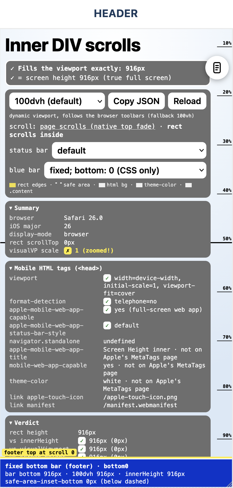

# Mobile screen height POC (Vue 3 + Vite)

<p align="center">
  
</p>

A proof of concept for laying out a full-height mobile web app (header at the top, footer at the bottom, scrolling content between)
that behaves on **iOS Safari, Firefox on iOS and as an iOS Home Screen web app** (iOS 27). It measures everything that influences
"screen height" and shows it in a debug panel.

> **Audience:** a coding session that wants to apply this layout to a mobile web app of its own. This README only contains the
> learnings and results of the tested state (latest tag `v5.0`; older states are tagged `v1.0`–`v4.0`). Evidence labels:
> **[device]** = observed by the owner on a real iPhone 16 Pro (402×874 @3x, iOS 27.0.1) · **[sources]** = third-party reports, no official
> Apple docs · **[untested]** = implemented here, not yet confirmed on a device.
> The owner leans towards the **"Inner DIV scrolls"** variant (`/inner.html`).

## 1. The layout to copy

Two pages show two ways to scroll. Both have the same header, footer and content; the structure is deliberately minimal:

| Page | URL | Who scrolls | DOM |
| --- | --- | --- | --- |
| **Full Page scrolls** | `/` | the document: native iOS top fade, Safari toolbars collapse | `main.screen` › `div.content` (+ fixed header, fixed footer) |
| **Inner DIV scrolls** | `/inner.html` | an inner container: the document never scrolls, toolbars keep their size | `main.screen` › `div.scroller` › `div.content` (+ fixed header, fixed footer) |

```css
:root { --header-h: 56px; --footer-h: 56px; }
html  { background: #fff; }                          /* canvas colour: see 2.5 */

.screen { position: relative; height: 100vh; height: 100dvh; }   /* the screen-high container */
@media (display-mode: standalone) { .screen { height: 100lvh; } } /* Home Screen app: see 3 */

.header { position: fixed; top: 0; left: 0; right: 0; z-index: 45; box-sizing: border-box; background: #fff;
          height: calc(var(--header-h) + env(safe-area-inset-top));
          padding-top: env(safe-area-inset-top); }      /* padding: the white also covers the status bar area */
.footer { position: fixed; bottom: 0; left: 0; right: 0; z-index: 40; box-sizing: border-box;
          height: calc(var(--footer-h) + env(safe-area-inset-bottom));
          padding-bottom: env(safe-area-inset-bottom); } /* padding, not margin: the footer colour fills it */

.content { box-sizing: border-box; min-height: 100%;     /* min-height, not height: see 2.7 */
           padding-top:    calc(var(--header-h) + env(safe-area-inset-top)    + 12px);
           padding-bottom: calc(var(--footer-h) + env(safe-area-inset-bottom) + 12px); } /* last content can leave the footer */

/* Inner DIV variant only: the document must not scroll */
.screen { overflow: hidden; }
.scroller { position: absolute; inset: 0; overflow-y: auto; }
/* Full Page variant: .screen keeps overflow visible, the content overflows it and the document scrolls. */
```

```html
<meta name="viewport" content="width=device-width, initial-scale=1, viewport-fit=cover"> <!-- real env(safe-area-inset-*) values -->
<meta name="apple-mobile-web-app-capable" content="yes">
<meta name="mobile-web-app-capable" content="yes">
<meta name="apple-mobile-web-app-status-bar-style" content="default"> <!-- tested; only read when the icon is added -->
<meta name="theme-color" content="#ffffff">                           <!-- same colour as the html background -->
<meta name="format-detection" content="telephone=no">
<link rel="manifest" href="/manifest.webmanifest">                     <!-- "display": "standalone", background/theme colour = html background -->
<link rel="apple-touch-icon" href="/apple-touch-icon.png">
```

Note: the POC's static `<head>` (`index.html`, `inner.html`) still says `black-translucent`; the owner's device tests used `default`, selected in the
debug panel (`?sb=default`) before adding the icon. `default` is the tested value.

See `src/style.css`, `src/components/AppHeader.vue`, `src/components/BottomBar.vue` and `src/views/*.vue` for the working code.
Page background of the POC: `--app-gradient: radial-gradient(120% 70% at 50% 10%, #ffffff 0%, #eef5fc 45%, #dbe8f6 100%)` on `#app`
(inner page) or `.content` (page scroll; there the document is taller than `#app`, the gradient must sit on the element that spans the whole
scrollable area). `html` stays white.

## 2. Learnings (Safari / Firefox tab)

1. **Viewport units** **[device]** (Safari, toolbars expanded): `innerHeight` = `100dvh` = `visualViewport.height` = 710, `100svh` = 710.33,
   `100vh` = `100lvh` = 748.33. So `100vh` / `lvh` is **38px taller than the visible area** and hides the bottom behind the toolbar.
   Use `dvh` (fallback `vh`). In the Inner DIV page the document never scrolls, so toolbars don't collapse and `dvh` = `svh` there.
   On the Full Page page `dvh` changes while the toolbars collapse (the rect resizes); `svh` would stay constant (not compared on the phone).
2. **Safari's address bar sits at the bottom and changes its size.** It floats over the page. When you swipe up (the **document** scrolls down), it shrinks into one
   compact address bar; swiping down (or back at the top) expands it again. The visible height (`innerHeight`, `100dvh`, `visualViewport.height`) changes
   with it, animated, firing hundreds of `resize` / `scroll` / `visualViewport` events (`100lvh` = the collapsed state). **[device]** It only reacts to the
   **document** scrolling: with an inner scroll container (Inner DIV page) it never changes size. **[device]** In Firefox on iOS the footer jumps to the very
   bottom while the document scrolls, i.e. Firefox hides its toolbar too. **[device]**
3. **Footer: plain `position: fixed; bottom: 0`, nothing else.** **[device]** In Safari it sits exactly on top of the floating controls and follows
   their shrink/grow animation without jumping; in Firefox it is placed correctly (it jumps to the very bottom while scrolling, acceptable).
   Do **not** position it with `top: calc(100dvh − h)` or from JS (`visualViewport` per frame): both run on the main thread and visibly
   lag/jump while the toolbar animates. **[device]**
4. **`safe-area-inset-bottom`: add it to the footer as padding (not margin).** **[device]** Safari tab: 0; Home Screen app: 34px; Firefox on iOS: the footer works fine
   (the latest test reported 0 as expected in a tab, an earlier one 34px). Padding means the footer's colour fills the area under the home indicator and the
   rounded screen corners do not cut off the footer's corners.
5. **Set the page background on the outermost HTML element (`html`).** **[device]** It is the canvas colour and shows wherever the document has no content: in the status bar
   zone above the document (behind the iOS blur), in rubber-band overscroll and while pulling down to reload. A background on an inner element (`#app`, `.content`) does not
   reach there. Use the same colour for `<meta name="theme-color">`.
6. **The area behind Safari's floating bottom toolbar shows the colour of the fixed footer** (blue in the screenshot above), not the page background.
   **[device, screenshot]** Presumably Safari extends the colour of a fixed element at the bottom edge into the area below the layout viewport.
7. **Content that must be at least N tall: `min-height`, not `height`.** With `height: 200%` taller children overflowed the content box and drew
   over the bare `html` background and the document grew past it.
8. **Reserve the footer's height as bottom padding of the scrollable content**, otherwise the last content can never be scrolled out from behind the fixed footer. **[device]**
9. **Header: `position: fixed; top: 0`, white, height = content + `env(safe-area-inset-top)` as padding.** **[device]** Works in Safari and Firefox tabs and as Home
   Screen app (see 3). In a tab the inset is 0, so it is just a 56px bar.
10. **Full Page scrolls vs Inner DIV scrolls:** Full Page gives the native iOS top fade (content fades out behind clock/battery), but the Safari toolbar
    shrinks/grows (item 2) and `dvh` moves. Inner DIV keeps the bottom iOS controls **at a constant size** because the root never scrolls **[device]**, but the
    scrolling content is clipped at the top of the viewport (no native fade under the status bar; an opaque header makes that moot).
11. **`apple-mobile-web-app-*` meta tags** (the only ones on Apple's [Supported Meta Tags](https://developer.apple.com/library/archive/documentation/AppleApplications/Reference/SafariHTMLRef/Articles/MetaTags.html)
    page: `viewport`, `format-detection`, `apple-mobile-web-app-capable` (`yes` = full-screen web app, detect with `navigator.standalone` or
    `matchMedia('(display-mode: standalone)')`), `apple-mobile-web-app-status-bar-style` = `default` / `black` / `black-translucent`, **no effect unless
    capable = `yes`**; `default` works everywhere **[device]**). `apple-mobile-web-app-title`, `mobile-web-app-capable`, `theme-color` are not on that page.
    The status-bar style is only read when the icon is added to the Home Screen (delete and re-add the icon after changing it). Recommended `<head>`: section 1.
12. **iOS version from the UA:** Safari 26+ freezes the OS token (`iPhone OS 18_7`); the real version is in `Version/27.0.1`. Use
    `max(OS, Version)`. Firefox/Chrome on iOS have no `Version` token. Because of item 2, never run expensive work (layout reads, `matchMedia` loops)
    per `resize` / `scroll` / `visualViewport` event.
13. **Small iOS details applied in the POC** (known iOS behaviour, not separately tested here): form controls need `font-size` ≥ 16px, otherwise iOS zooms in on focus
    (and `visualViewport.scale` ≠ 1); `-webkit-text-size-adjust: 100%` stops iOS from enlarging text in landscape; touch targets of at least 44px.

## 3. Home Screen app (standalone)

**iOS 27 adds a rather large blur at the top edge of installed web apps.** The system draws a translucent veil over the top of the page (not the page itself):
it reaches well below the status bar and washes out whatever sits there. No meta tag or CSS property turns it off; the workarounds that people report (an opaque
`position: fixed` or `sticky` element with a background at the top edge) only colour the blurred area. The iOS accessibility setting *Reduce Transparency* removes it.
**[sources]**

* r/PWA: [iOS 27 beta blurs the top edge of installed PWAs](https://www.reddit.com/r/PWA/comments/1w5mqj1/ios_27_beta_blurs_the_top_edge_of_installed_pwas/)
* [grappa-irc#2190](https://github.com/vjt/grappa-irc/issues/2190): measurements of the band (inset 62px, a veil that fades out at about 100 CSS px)
* [milkbox#55](https://github.com/kypflug/milkbox/pull/55): "Keep iOS 27's top blur off the installed app" (no meta tag or CSS property found; WebKit looks at a fixed box at the top edge)
* [OJapp tips: removing the top blur in iOS 27 PWAs](https://tips.ojapp.app/en/ios-27-pwa-top-blur-workaround-2/) (workarounds, e.g. a sticky header with background and inset padding)
* [meshmonitor#5286](https://github.com/Yeraze/meshmonitor/issues/5286): status-bar backdrop blur bleeds into a fixed header
* [pullcord#97](https://github.com/jakswa/pullcord/pull/97): cover the top safe-area inset so the header does not blur under the status bar
* [rhams.es#12](https://github.com/rhamses/rhams.es/pull/12): blur content under the iPhone status bar; [romm#5075](https://github.com/rommapp/romm/pull/5075): draw under the iOS status bar and respect the safe-area insets
* [Daniel Pietzsch: a blurry status bar for PWAs on iOS](https://danielpietzsch.com/articles/how-to-create-a-blurry-status-bar-for-pwas-on-ios)

Results on the device:

* **The large blur only exists in the installed app**; in a Safari/Firefox tab it is small, as high as the top iOS controls. **[device]** In the installed app
  `safe-area-inset-top` = **62px**, `safe-area-inset-bottom` = **34px**, and the page is drawn under the status bar even with `apple-mobile-web-app-status-bar-style: default`.
* **Use the area with a fixed, opaque header whose padding covers the inset** (section 1): the blur sits over the header, the content starts below it. **[device: works]**
  A coloured strip alone (a "blur shield") only turns the blurred area into one coloured area and gives no extra usable height. **[device]**
* **iOS starts the installed app with a stale viewport.** At launch `innerHeight` = `100dvh` = `100svh` = `html.clientHeight` = **812** (= 874 − 62) while the screen is 874 and
  `100lvh` is already 874; something positioned with `100dvh` sits 62px too high (white strip below the footer) until the first scroll/pull makes `innerHeight` / `dvh` jump to 874
  (`html.clientHeight` stays 812). **[device]**
* **Fix: `@media (display-mode: standalone) { .screen { height: 100lvh } }`.** There are no collapsing toolbars in an installed app, so `lvh` is the true full height
  from the first frame; the footer stays plain `bottom: 0`. **[device: works]** Side effect: the container (874) is taller than the stale layout viewport (812), so the
  document can scroll by 62px.

## 4. Still to test

- [ ] Landscape (side insets, footer, `innerHeight`); iPad.
- [ ] The on-screen keyboard (an input in the content or footer): what the fixed header/footer and `visualViewport` do while it is open. The POC has no inputs.

## 5. Run and test

```bash
npm install
npm run dev        # listens on the LAN (any Host header allowed): open the "Network" URL on the phone
npm run build      # type-check + production build into dist/
npm run preview    # serve dist/ on the LAN
```

> **iOS Safari caches very aggressively** (HTML, JS, CSS, manifest, icons, even with the dev server). A normal reload often does *not* show code changes.
> Open the URL in a **new private tab** to really get the latest version; the panel's *Reload* button is not enough. For a Home Screen app delete
> the icon and add it again (also needed for the status-bar style). When a value looks like "the old code", suspect the cache first.

Phone and Mac on the same Wi-Fi, or a public tunnel to the dev server, e.g. a Cloudflare quick tunnel (no account; anyone with the link can open it,
including the source files the dev server serves):

```bash
brew install cloudflared
cloudflared tunnel --url http://localhost:5173   # prints a random https://….trycloudflare.com URL
```

For LAN host names and the tunnel the dev server must accept any `Host` header: `server: { host: true, allowedHosts: true }` in `vite.config.ts`.
A Home Screen icon added from a tunnel URL stops working when the tunnel (and its random URL) goes away.

Test matrix: iOS Safari tab · Firefox on iOS tab (a WKWebView shell: same WebKit, own toolbars and
insets) · Home Screen app (Share → *Add to Home Screen*, keep *Open as Web App* on).

## 6. The debug tooling

Settings live in the URL (so *Reload* keeps them, there is no reload button in a Home Screen app): `?h=<height mode>&sb=<status bar style>&bar=<footer strategy>`.
*Copy JSON* copies all measurements for comparing devices. A round button at the top right (100px below the top) switches between the two pages.

* **Verdict:** rect height vs `innerHeight` / `visualViewport.height` / screen height (in the Home Screen app the screen height), rect top/bottom,
  document scroll range, content ≥ 200 % (it grows when the debug panel is taller), a "viewport vs screen" row that shows the stale launch viewport.
* **Summary** (browser, iOS major, display-mode, scroll position, pinch-zoom scale) and **Mobile HTML tags** (live values of the `<head>` tags, checked against Apple's page).
* **Yellow lines:** top/bottom edge of the rectangle; a yellow line "footer top at scroll 0" on the footer's top edge before scrolling; a dashed white line inside the
  footer where the safe-area padding starts (the footer's 3rd text line shows the measured inset); dashed black lines for the insets; a black ruler in the right gutter
  (ticks every 10 % of the rect height). The rectangle itself has no colour.
* **Height modes** (select): `dvh` (default), `svh`, `lvh`, `vh`, `percent`, `fill` (`-webkit-fill-available`), `js` (`innerHeight`), `fixed` (inner page only).
  **Footer strategies** (`?bar=`): `bottom0` (default), `dvh`, `js`, `off`. In the Home Screen app the default `dvh` height mode is overridden by `100lvh`.
* Measured live (events + 500 ms polling): `screen.*`, `devicePixelRatio`, `window.inner/outer*`, `documentElement.client*`, `visualViewport.*`, probe elements for
  `100vh/svh/lvh/dvh`, `env(safe-area-inset-*)` and `-max-inset-*`, media queries, `prefers-reduced-transparency`, scroll state, an event counter.

Files: `index.html` + `src/views/PageScrollView.vue` (Full Page) · `inner.html` + `src/views/InnerScrollView.vue` (Inner DIV) · `src/components/`
(`AppHeader`, `BottomBar`, `DebugPanel`, `ScrollRuler`, `EdgeOverlay`, `FooterLine`, `ViewSwitch`) · `src/composables/` (`useSettings`, `useViewportMetrics`) ·
`src/lib/environment.ts` (browser / iOS version / Home Screen detection) · `src/style.css` (shared variables, `.screen`, `.content`, height modes) ·
`public/manifest.webmanifest` · `scripts/make-icons.mjs` (`npm run icons`).
